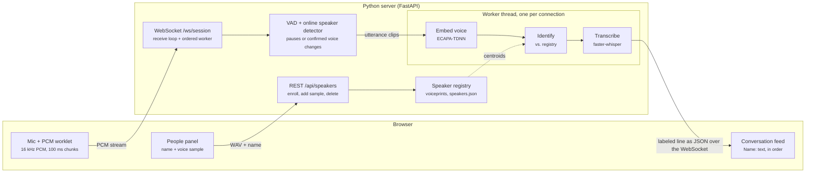

# Convo Tracker — Build Guide

> **For agents and contributors:** this is the design guide for Convo Tracker. It was exported from the living doc at <https://claude.ai/artifact/9ehCbJqMnZiB5wGzGffQ1y> on 2026-11-03. Iterate on the idea here: update this file when the design changes. Keep it in sync with [`SPEC.md`](SPEC.md), the binding frontend/backend contract, and with the code. If they disagree, the code and `SPEC.md` win, and this guide should be corrected.

## Overview

Convo Tracker turns a live conversation into a transcript where every line is labeled with who said it. Version 1 uses **enrollment first**: each person records a short voice sample and types their name, then the app listens and attributes each utterance to the closest enrolled voice.

**How a session runs**

1. **Enroll.** For each person: type a name, press Record, speak for about 8 seconds, press Stop. The server turns the clip into a voiceprint (a speaker embedding) and stores it.
2. **Listen.** Press Start. The browser streams microphone audio to the Python server over a WebSocket.
3. **Segment.** The server splits the stream at pauses and confirmed speaker changes, including interruptions without a pause.
4. **Identify and transcribe.** Each utterance is checked for a change of speaker, gets a voiceprint compared against every enrolled person, and a speech-to-text transcript; a change of speaker without a pause becomes separate lines.
5. **Display.** The browser appends `Name: text` to the conversation feed, in order.

**Goals for v1**

- One browser tab, one shared microphone in the room, 2 to 6 speakers.
- Each line appears within roughly 1 to 3 seconds after the speaker pauses (CPU, Whisper `base.en`).
- Lines that match no one well enough are labeled **Unknown** instead of being forced onto someone.
- Everything runs locally; no cloud API keys.

**Not in v1**: accounts, a database, multiple rooms, separating two people who talk at the same time, and automatic discovery of new speakers (that is approach two, in the roadmap).

## Architecture

The browser captures audio and shows results; a single Python server does all the recognition. Enrollment clips go over REST; live audio streams over one WebSocket.



The receive loop feeds VAD and online speaker-change detection through `asyncio.to_thread`, then queues completed turns to an ordered transcript worker. A confirmed incoming speaker can be announced before the previous turn finishes transcription. The transcript queue is bounded; overload drops its oldest waiting utterance and reports an error.

## Tech stack

The backend is Python with FastAPI; the frontend is plain HTML, CSS and JavaScript with no build step. Standard dependencies include faster-whisper for real speech-to-text. SpeechBrain and PyTorch are optional for stronger speaker recognition; tests use fake models and do not download model files.

| Layer | Component | Why |
| --- | --- | --- |
| Web server | FastAPI + Uvicorn | Async, native WebSockets, auto-validated REST routes, serves the static frontend |
| Speaker voiceprints | SpeechBrain ECAPA-TDNN (`speechbrain/spkrec-ecapa-voxceleb`, 192-dim) | Strong open speaker-verification model, runs on CPU, no API key |
| Fallback voiceprints | MFCC statistics embedder (NumPy + SciPy) | Works with no PyTorch; used for tests and offline demos |
| Speech-to-text | faster-whisper, model `base.en`, int8 on CPU | Whisper accuracy at roughly 4x the speed of the reference implementation |
| Explicit test/development STT | Null transcriber | Only `CT_TRANSCRIBER=null` emits `[speech 2.3s]` placeholders; never an automatic fallback |
| Voice activity detection | Custom streaming energy VAD (NumPy), 30 ms frames | No extra dependency; adaptive noise floor; tunable pause length |
| Audio decoding | soundfile + `scipy.signal.resample_poly` | Reads any WAV, downmixes and resamples to 16 kHz |
| Storage | In-memory registry + `data/speakers.json` | Enough for one room; atomic writes survive restarts |
| Browser audio | `getUserMedia` + AudioWorklet | Low-latency raw PCM capture; resampled to 16 kHz in the browser |
| Frontend UI | Vanilla ES modules, CSS | Keeps v1 simple; no framework or bundler |
| Tests | pytest, httpx `TestClient`, Playwright (Chromium) | Unit, API and WebSocket tests; headless browser smoke test with a fake mic |

Install tiers: `backend/requirements.txt` (standard runtime, including faster-whisper and PyAV), `backend/requirements-ml.txt` (adds SpeechBrain, PyTorch and torchaudio), `backend/requirements-dev.txt` (standard runtime plus pytest and httpx). `auto` and `whisper` both require real transcription to load successfully; missing dependencies or model-download failures stop startup with an actionable error. Only explicit `CT_TRANSCRIBER=null` permits placeholders, with a terminal warning and UI notice.

## Frontend components

The page has two panels: **People** (enroll voices) and **Conversation** (live labeled transcript). Each piece below is one ES module or one UI region.

| Component | File | Responsibility |
| --- | --- | --- |
| Enrollment form | `index.html`, `js/app.js` | Name input + Record button. Record turns into "Stop (0:07)" with a timer and level meter. Stop unlocks after 3 s; auto-stops at 15 s. Errors show inline. |
| People list | `js/app.js` | Color dot, name, sample count, "+ sample" (record another clip for better accuracy), delete, Remove all. |
| Listen controls | `js/app.js` | Start / Stop listening. Disabled until at least one person is enrolled. Stop shows "Finishing…" until the server confirms all lines are out. |
| Speaking indicator | `js/app.js` | Lights up while VAD hears speech and shows the speaker name when a live `speaker` event arrives. |
| Conversation feed | `js/app.js` | One line per utterance: colored name chip, text, mm:ss time, confidence on hover. Unknown lines are muted. Auto-scrolls unless you scrolled up. `aria-live="polite"`. |
| Clear / Export | `js/app.js` | Clear the feed; download a `.txt` of `[mm:ss] Name: text` lines. |
| Audio capture | `js/audio.js` | `AudioCapture` class: microphone via `getUserMedia`, or shared computer audio via `getDisplayMedia`; both use the same AudioWorklet. The common Audio input selector applies to enrollment and live transcription. Only audio is sent; microphone audio is not mixed into computer capture. `MicCapture` remains a compatibility alias. |
| PCM worklet | `js/pcm-worklet.js` | AudioWorkletProcessor: downmix to mono, resample to 16 kHz without drift between blocks, convert to Int16, post 100 ms chunks (1,600 samples) plus an RMS level. |
| WAV encoder | `js/wav.js` | Wraps recorded Int16 chunks in a 44-byte RIFF header for upload. |
| REST client | `js/api.js` | `fetch` wrappers; surfaces the server's `detail` message on errors. |
| Session socket | `js/session.js` | WebSocket client for `/ws/session`: start, stream binary audio, stop, dispatch status / speech / speaker / utterance / error events. |

Rules that keep it safe and simple: server or user text is rendered with `textContent` only (no `innerHTML`), enrollment recording and live listening are mutually exclusive, and the mic only works on `https` or `localhost`.

## Backend components

The backend is a small FastAPI package, `backend/app`, with one module per job. ML models load once at startup and are shared by every request.

| Module | Key class / function | Responsibility |
| --- | --- | --- |
| `main.py` | `create_app()` | Builds the app, loads models in a lifespan handler, mounts `/api`, `/ws`, and the frontend at `/` |
| `config.py` | `Settings` | Reads `CT_*` environment variables (thresholds, model names, data dir) |
| `state.py` | `AppState` | Holds the shared registry, embedder and transcriber |
| `api/speakers.py` | REST router | Enroll, add sample, list, delete speakers; validates name, size, speech length |
| `api/session.py` | `/ws/session` | Receives PCM frames, feeds the segmenter, queues utterances to a per-connection worker, sends results in order |
| `audio/io.py` | `decode_wav()`, `pcm16_to_float()` | Any WAV to 16 kHz mono float32; raw PCM bytes to float32 |
| `audio/vad.py` | `Segmenter` | Streaming energy VAD: 30 ms frames, adaptive noise floor, 300 ms pre-roll, 700 ms end-of-speech pause, 15 s max |
| `speakers/embedder.py` | `EcapaEmbedder`, `MfccEmbedder` | Audio to an L2-normalised voiceprint vector |
| `speakers/registry.py` | `SpeakerRegistry` | Stores voiceprints (samples, augmented, adaptive), identifies speakers by centroid/prototype similarity, persists to JSON, thread-safe |
| `speakers/turns.py` | `detect_turns()` | Finds speaker changes inside one segment with sliding-window voiceprints |
| `transcription/transcriber.py` | `WhisperTranscriber`, `NullTranscriber` | Audio to text |
| `pipeline.py` | `SessionPipeline` | Glues it together: segment, split into speaker turns, embed, identify, transcribe, emit one `Utterance` per turn |

**Concurrency.** The WebSocket receive loop awaits serialized feed/flush operations through `asyncio.to_thread`; these run VAD and online voice-change probes off the event loop. A separate worker per connection processes completed segments in order through `asyncio.to_thread`, so transcription does not hold up live speaker events. Its bounded deque preserves status markers; overload drops the oldest waiting audio segment and reports an error.

**Configuration** (environment variables)

| Variable | Default | Meaning |
| --- | --- | --- |
| `CT_EMBEDDER` | `auto` | `ecapa`, `mfcc`, or `auto` (ECAPA if installed) |
| `CT_TRANSCRIBER` | `auto` | `auto` and `whisper` require real STT; `null` explicitly enables development placeholders |
| `CT_WHISPER_MODEL` | `base.en` | faster-whisper model name or a downloaded model directory for offline use |
| `CT_DEVICE` | `cpu` | `cpu` or `cuda` |
| `CT_MATCH_THRESHOLD` | embedder default (ECAPA 0.30) | Minimum cosine similarity to name a speaker |
| `CT_SILENCE_MS` | `700` | Pause that ends an utterance |
| `CT_MAX_UTTERANCE_S` | `15` | Force-cut long monologues |
| `CT_MIN_UTTERANCE_S` | `0.5` | Drop clicks and coughs |
| `CT_DATA_DIR` | `./data` | Where `speakers.json` lives |
| `CT_TURN_MIN_SEGMENT_S` / `CT_TURN_WINDOW_S` / `CT_TURN_HOP_S` / `CT_TURN_MIN_S` | `2.0` / `1.5` / `0.5` / `1.0` | Speaker-change detection inside an utterance |
| `CT_ENROLL_AUGMENT` | `1` | Store pitch/speed-perturbed enrollment voiceprints |
| `CT_ADAPT` | `1` | Learn in-memory prototypes from confident live speech |
| `CT_HOST` / `CT_PORT` | `127.0.0.1` / `8000` | Server bind address |

## API contract

Enrollment uses REST; live listening uses one WebSocket. All audio is 16 kHz, mono, 16-bit little-endian PCM, and the browser does the resampling. The full contract lives in [`SPEC.md`](SPEC.md).

**REST** (prefix `/api`)

| Method | Path | Body | Success | Errors |
| --- | --- | --- | --- | --- |
| GET | `/api/health` | none | `{status, embedder, transcriber}` | none |
| GET | `/api/speakers` | none | `{speakers: [Speaker]}` | none |
| POST | `/api/speakers` | multipart: `name`, `audio` (WAV) | 201 `Speaker` | 400 bad name / audio / under 2 s speech; 409 duplicate name; 413 over 10 MB or 60 s |
| POST | `/api/speakers/{id}/samples` | multipart: `audio` | 200 `Speaker` | 400, 404, 413 |
| DELETE | `/api/speakers/{id}` | none | 204 | 404 |
| DELETE | `/api/speakers` | none | 204 | none |

`Speaker` = `{id, name, color, num_samples, created_at}`.

**WebSocket** `/ws/session`

| Direction | Message | Meaning |
| --- | --- | --- |
| Client to server | `{"type":"start"}` | Begin a session; resets the segmenter |
| Client to server | binary frame | Raw PCM16 audio, about 100 ms per frame |
| Client to server | `{"type":"stop"}` | Flush the last utterance, finish the queue, then confirm |
| Server to client | `{"type":"status","state":"listening" or "stopped"}` | Session state |
| Server to client | `{"type":"speech","active":true or false}` | Someone started or stopped talking |
| Server to client | `{"type":"utterance", id, seq, speaker_id, speaker_name, color, text, start, end, confidence}` | One labeled line; `speaker_id` is null for Unknown |
| Server to client | `{"type":"error","message":...}` | Recoverable problem, such as malformed JSON |

Utterances arrive in `seq` order; `start` and `end` are seconds since the session began. Empty transcripts are not sent.

## Speaker recognition

Each utterance is assigned to the enrolled person whose voiceprints are most similar, as long as the similarity clears a threshold (0.30 for ECAPA); otherwise it is labeled Unknown. When the speaker changes inside one stretch of speech with no pause, the stretch is split into one line per speaker.

**Loudness normalisation**

Before any clip is embedded (enrollment and live), its voiced frames are scaled to about -23 dBFS, with a peak limit so nothing clips. Near-silent clips are left alone. Speaking louder or sitting further from the mic therefore no longer moves the voiceprint.

**Enrollment**

1. Trim silence from the sample with the same VAD used live.
2. Reject the sample if less than 2 s of speech remains.
3. Slide a 3 s window with a 1.5 s hop over the speech, embed each window, average, and re-normalise. Averaging windows smooths over one odd syllable.
4. Store it as one sample. A person's **centroid** is the normalised mean of all their samples, so "+ sample" improves accuracy.
5. **Augmentation** (`CT_ENROLL_AUGMENT`, on by default): the sample is also embedded after speed perturbation at 0.9x and 1.1x (pitch about -1.8 / +1.65 semitones, the standard speaker-recognition "speed perturb") and, when torchaudio is installed, after pure pitch shifts of ±2 semitones. These **augmented** voiceprints are stored with the sample in `speakers.json`; they do not count as extra samples. They teach the registry what the person sounds like a little higher or lower than in the recording.

The People panel suggests recording 2–3 samples per person: normal voice, louder or more animated, quieter.

**Identification**

Each person has a set of **prototypes**: their real sample voiceprints, the augmented ones, and any adaptive ones (below). The score of an utterance voiceprint `u` against a person is

```
score = max( cos(u, centroid), mean of the 2 highest cos(u, p) over the person's prototypes p )
```

so an utterance that matches one variant of the voice well (for example the higher-pitched copy) scores high even if it is far from the average.

1. Compute the score against every enrolled person.
2. Best score at or above `CT_MATCH_THRESHOLD`: label with that person.
3. Below it: label **Unknown** (gray), keeping the line in the transcript.
4. **Continuity smoothing** for very short utterances (under 1 s): if the top two scores are within 0.05 and one of them is the previous speaker, keep the previous speaker. Short clips like "yeah" give noisy voiceprints, and conversations usually stay with one speaker.

**Adaptive prototypes** (`CT_ADAPT`, on by default). When a live line with at least 2 s of speech is identified very confidently, its voiceprint is added as an extra prototype for that person. "Confidently" is judged on the **static** score (enrolled and augmented voiceprints only, never the adaptive ones, so they cannot vouch for their own successors and drift): at least threshold + 0.15 and at least 0.10 above the runner-up (threshold + 0.25 if only one person is enrolled), and the cosine to the person's centroid must clear the threshold. Only whole lines where turn analysis saw a single voice adapt; split pieces never do. Adaptive prototypes also only raise the score of someone who already matches on enrolled evidence, so they can never turn an Unknown voice into a person. They are kept in memory only (never saved), at most 20 per person (oldest dropped first), and are discarded when the person is deleted. Recognition therefore follows how someone sounds today, in this room, without risking the stored enrollment.

**Speaker turns inside one utterance** (change-point detection). The segmenter only cuts on pauses, so an interruption with no pause used to end up in the previous speaker's line. For a segment with at least 2 s of speech (`CT_TURN_MIN_SEGMENT_S`) and at least two enrolled people:

1. Lay 1.5 s windows with a 0.5 s hop over the segment (`CT_TURN_WINDOW_S`, `CT_TURN_HOP_S`; at most 40 windows), skipping mostly silent windows. "Silent" uses the VAD's own absolute threshold (noise floor + 10 dB), so a person far from the mic still counts.
2. **Chunk pre-check**: embed only the windows that tile the segment end to end (about one segment's worth of audio, one batch). If every chunk confidently picks the same person (static score above the threshold and 0.10 ahead of the runner-up), stop: one turn, and the mean chunk voiceprint stands in for the whole segment. Most single-speaker segments cost about one embedding of the segment instead of about four.
3. Otherwise embed the remaining windows (reusing the chunks) and label each with its best-scoring person, or Unknown.
4. Smooth: a single window that disagrees with both neighbours (or, at either end, with its two inner neighbours) takes their label. A short Unknown run (at most one window long) between two different people is the moment of the change, where windows hold both voices; it is split between them. Runs of 1 s or less (`CT_TURN_MIN_S`) or of a single window join the neighbour that fits them better.
5. Cut between runs, midway between their window centres. When the two sides differ in loudness by 10 dB or more, the cut moves to the sharpest loudness step nearby (the louder voice dominates mixed windows).

With one turn, nothing changes. With several, Whisper's word timestamps assign each word to the turn containing its midpoint, and consecutive words of one turn become one line whose times snap to its first and last word (always in time order, never zero-length). Words are joined as Whisper spaces them, so Chinese or Japanese lines get no spurious spaces. `transcribe_words` returning an empty list means nothing was said (no line); `None` means the transcriber has no word timestamps (the null transcriber), and then the audio is cut at the turn boundaries and each piece is transcribed alone. Each piece of 1 s or more is then re-identified from its own audio, which is more accurate than 1.5 s windows; neighbouring pieces that end up with the same person are joined again, so a false split heals itself. Every piece is sent as its own utterance with its own `seq`.

**Tuning.** Raise the threshold if people get mixed up; lower it if too many lines are Unknown. If lines get split when only one person spoke, raise `CT_TURN_MIN_S` or `CT_TURN_WINDOW_S`; if quick replies are missed, lower them. The MFCC fallback is much weaker and uses 0.80; it is meant for tests, not real rooms.

## Repo, running, and testing

The code lives in `prodyradstudios/convo-tracker`. One command starts the server, which also serves the page.

**Layout**

```
backend/
  app/            FastAPI package (modules in Backend components)
  tests/          pytest suite, fake models and no model downloads
  requirements.txt, requirements-ml.txt, requirements-dev.txt
frontend/
  index.html, styles.css
  js/             app, api, audio, pcm-worklet, wav, session
docs/SPEC.md        frontend/backend contract
docs/BUILD_GUIDE.md this guide
```

**Run locally**

1. `python -m venv .venv && source .venv/bin/activate`
2. `pip install -r backend/requirements.txt` (real Whisper transcription and basic MFCC speaker matching)
3. `cd backend && python -m app`
4. Open `http://localhost:8000`, enroll each person, press Start listening.

First start downloads Whisper `base.en` from Hugging Face. For stronger speaker recognition, also install `backend/requirements-ml.txt` with `--extra-index-url https://download.pytorch.org/whl/cpu` on Linux/Windows; ECAPA downloads its model on first start. Model access must work before startup can succeed. A downloaded faster-whisper model directory can be selected through `CT_WHISPER_MODEL`. Remove any `CT_TRANSCRIBER=null` startup override to restore spoken words.

**Testing**

- **Unit**: VAD on synthetic tones and silence; WAV decoding at other sample rates; embedder determinism and loudness normalisation; augmentation; registry matching, prototype scoring, adaptive prototypes, Unknown, smoothing and persistence; speaker-turn detection and smoothing; pipeline splitting with and without word timestamps.
- **API**: every REST route and error code through FastAPI's `TestClient`.
- **WebSocket end-to-end**: fake embedder and transcriber; checks ordering, an interruption without a pause becoming two lines, ignored pre-start audio, malformed JSON.
- **Browser smoke test**: Playwright Chromium with a fake microphone; checks the page loads cleanly and enrollment works.

**Adversarial review.** After the build agents finish, a separate reviewer agent that wrote none of the code reads the whole repo hunting for bugs: race conditions in the WebSocket worker, audio math errors, API contract mismatches, XSS, and resource leaks. Each confirmed finding is fixed with a regression test, then the suite is rerun.

## Limitations and roadmap

V1 handles people taking turns, including interruptions without a pause. The biggest gaps are simultaneous speech and speakers who never enrolled.

**Known limitations**

- **Overlap**: when two people talk at the same time, the voices are not separated; each 1.5 s window goes to whichever voice dominates it, and the words are attributed to that speaker.
- **Very quick exchanges**: the rapid detector preserves short, confidently different turns, using 400 ms windows, 100 ms probe hops and 200 ms of confirming evidence by default. Weak or shorter evidence can still be smoothed away. These audio evidence settings are not a wall-clock latency guarantee; model inference adds time.
- **Short replies**: one-word utterances carry little voice information, so they are the most likely to be mislabeled.
- **Large voice changes**: augmentation covers about ±2 semitones and loudness; shouting, whispering or a cold can still push a voice beyond that. Adding a sample in that voice helps; adaptive prototypes help during a session but are forgotten on restart.
- **Room acoustics**: a far-away or echoey mic lowers similarity scores. Enroll in the same room and mic setup you will record in.
- **CPU latency**: Whisper speed depends on the machine and utterance length; `small.en` is more accurate but slower than `base.en`. Online detection uses cheap acoustic checks plus periodic model probes. Offline analysis has separately bounded short-window and coarse passes; word timestamps add transcription work when a segment has several speakers.
- **Single room**: speakers are global to the server; there are no accounts or separate rooms.

**Roadmap**

1. **Approach two: automatic new-speaker discovery.** Reuse the same pipeline. When an utterance's best score is below the threshold, start a provisional cluster ("Person 3"). Later Unknown utterances join the nearest cluster if close enough, else start another. After about 10 s of speech, a cluster becomes a full speaker the user can rename. Enrollment then becomes optional.
2. **Overlap handling**: detect overlapped speech and, eventually, separate it (target-speaker extraction) so both people's words are kept.
3. **Neural VAD** (Silero) to replace the energy VAD in noisy rooms.
4. **Persistence and export**: save sessions to SQLite; export JSON and SRT.

Done since the first version: change-point detection inside an utterance and adaptive per-speaker prototypes (see Speaker recognition), plus loudness normalisation and pitch/speed enrollment augmentation.
